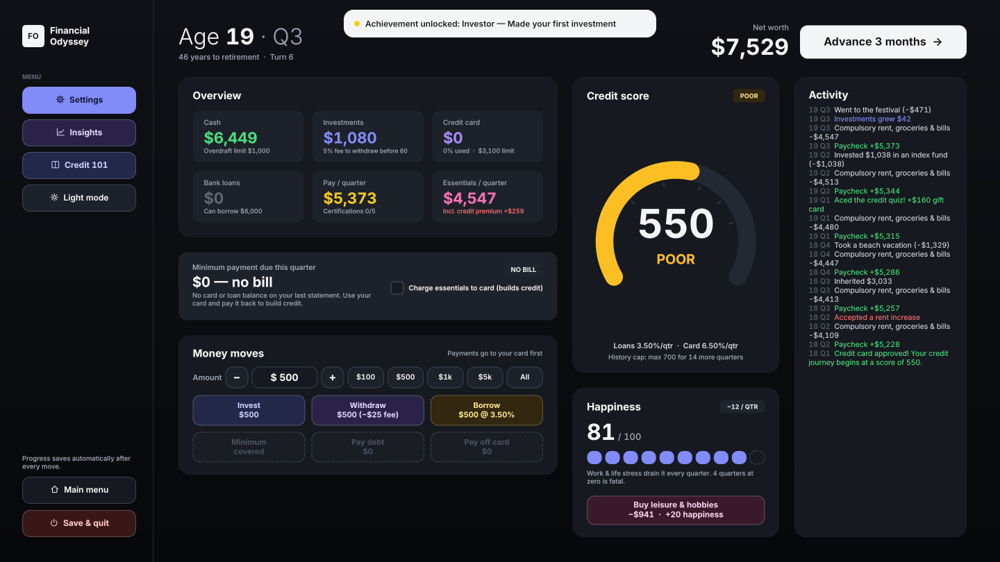
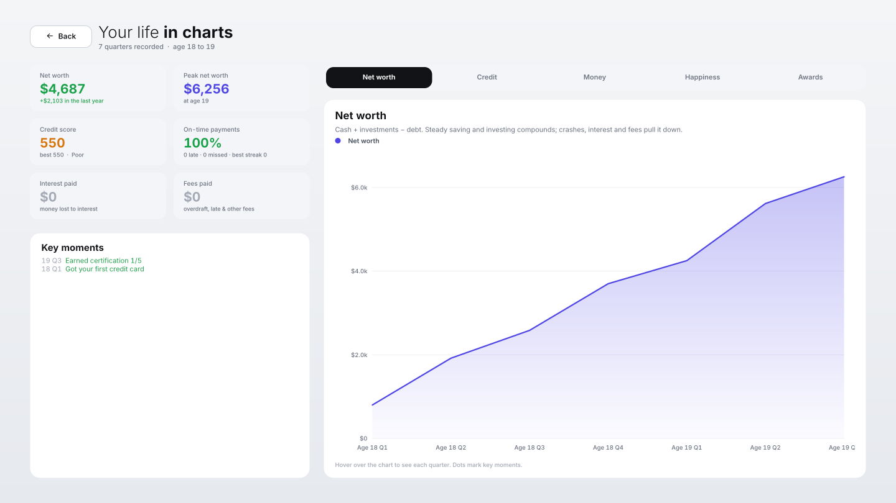
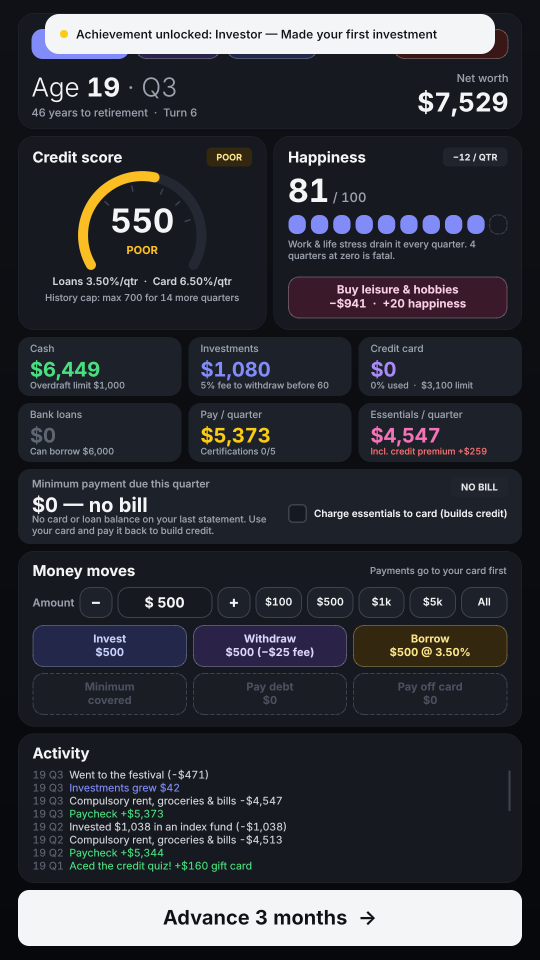

# Financial Odyssey: 18 to 65

A life-simulation game about **credit, debt and building wealth**, made for the Warwick Hackathon 2026 (WHACK, Capital One track).

You start at 18 with $800 and your first credit card. Each turn is one quarter (3 months). You get paid, rent and bills come out, and a life event asks you to choose. Pay your bills, build your credit score, invest, and stay happy until you retire at 65 (or earlier, once you reach $1M).



| Insights ("Your life in charts") | Mobile layout |
|---|---|
|  |  |

---

## Quick start

Requires **Python 3.10+**.

```bash
pip install -r requirements.txt
```
```bash
python main.py
```

`python -m financial_odyssey` works too.

**Controls:** mouse only. **F11** toggles fullscreen and **Esc** leaves it.

---

## How to play

| Thing | What it means |
|---|---|
| **Cash** | Your bank balance. It can go up to $1,000 negative (overdraft), which costs a $35 fee plus interest. |
| **Credit card** | Has a limit set by your credit tier. Paying the full statement means no interest (grace period). |
| **Minimum payment** | Due every quarter: 4% of the card balance plus 8% of loans. Paying less counts as **late (−20)** and paying nothing as **missed (−50)**. |
| **Credit score** | Starts at 550. It only rises when you pay on time, and paying in full rises it most. It can't pass 700 until you have 5 years of history. |
| **Credit tiers** | Very Poor, Poor, Fair, Good and Excellent. Your tier sets loan and card rates, your card limit, how much you can borrow, and even your rent and bills (−8% to +16%). |
| **Bank loans** | Cheaper than a card, but you need a score of at least 450. |
| **Investments** | Grow about 5–6% a year with occasional crashes. Withdrawing before 60 costs a 5% fee. |
| **Happiness** | Drains every quarter. **Buy leisure & hobbies** refills it. Four quarters at 0 is game over. |
| **Life events** | 25 kinds: festivals, car repairs, layoffs, inheritances, scams, credit quizzes and more. |

### Ways the game ends
- **Retirement at 65**, or **early retirement** any time your net worth is at least $1M.
- **Depression:** happiness stays at 0 for 4 quarters.
- **IRS seizure:** your credit stays under 300 while you keep missing payments for 8 quarters.

### Final score
Net worth × **credit multiplier**, which ranges from 0.50 for Very Poor up to 2.00 for 900+. If the game ends early, the score is cut and a penalty is subtracted.

### Learning aids
- **Guided tutorial** (19 steps) on your first game. To see it again, use Settings → Replay tutorial.
- **First-time tips** explain each button the first time you use it.
- **Credit 101** guide, plus popups explaining why your credit fell and how to recover.
- **Insights** page with charts of net worth, credit, money and happiness, a key-moments timeline and awards.

### Tip
Turn on **Charge essentials to card**, then pay the statement in full each quarter. Your credit grows every quarter and you never pay card interest.

---

## Saving & settings

Progress saves automatically after every move and when the window closes. On the start screen you can **Resume** or **Start a new credit card**, which asks before deleting your save.

Files are stored in your user app-data folder:

| OS | Folder |
|---|---|
| Windows | `%APPDATA%\FinancialOdyssey\Financial Odyssey\` |
| macOS | `~/Library/Application Support/FinancialOdyssey/Financial Odyssey/` |
| Linux | `~/.local/share/FinancialOdyssey/Financial Odyssey/` |

- `savegame.json` holds the current game.
- `settings.json` holds the theme, layout, and tutorial/tips progress.

Settings offer a **light/dark** theme, a **mobile (portrait)** or **desktop (landscape)** layout, and fullscreen. Every screen is drawn on a fixed canvas and scaled to fit the window, so the layout looks the same at any window size.

---

## Project structure

```
main.py                      launcher: python main.py
requirements.txt
financial_odyssey/
├── __main__.py              python -m financial_odyssey
├── app.py                   creates the QApplication and main window
├── formatting.py            money() and esc() text helpers
├── storage.py               app-data folder, safe JSON read/write
├── engine/                  pure game logic, no Qt (usable from scripts/tests)
│   ├── config.py            GameConfig: every balance number (economy, banking, tiers…)
│   ├── content.py           achievements and credit-quiz questions
│   ├── state.py             GameState: setup, save/load, history, read-only helpers, scoring
│   ├── credit.py            CreditSystem: credit score changes and credit-drop popups
│   ├── banking.py           Banking: end-of-quarter payments, interest, overdraft, collections
│   ├── actions.py           MoneyMoves: invest, withdraw, borrow, pay, buy happiness, retire
│   ├── events.py            LifeEvents: the event deck, 25 events, applying choices
│   └── game.py              LifeGame: the quarterly turn loop and Credit 101 guide
└── ui/                      PyQt6 interface
    ├── theme.py             canvas sizes, light/dark palettes, fonts, stylesheet
    ├── widgets.py           labels, buttons, cards, icons, credit gauge, tiles…
    ├── overlays.py          event, popup and settings overlays; toasts
    ├── tutorial.py          guided tutorial and first-time tips
    ├── charts.py            line chart used by Insights
    ├── game_ui.py           GameUI controller: owns pages/overlays, routes actions
    ├── view.py              ScaledView: scales the canvas into the window
    ├── window.py            MainWindow: saving, settings, theme/layout, fullscreen
    └── pages/
        ├── start.py         start screen (resume / new game)
        ├── dashboard.py     the main game screen (mobile and desktop layouts)
        ├── game_over.py     end screen with score breakdown
        └── insights.py      "Your life in charts"
tests/
└── test_engine.py           rule checks for the engine
```

### How the engine fits together

`LifeGame` is built up in layers. Each file adds one class on top of the previous one:

```
GameConfig → GameState → CreditSystem → Banking → MoneyMoves → LifeEvents → LifeGame
```

Each layer only calls methods from the layers below it, so every file can be read on its own, and type checkers like Pyright understand the code fully.

The engine never imports Qt, so you can drive it directly:

```python
from financial_odyssey.engine import LifeGame

g = LifeGame(seed=42)
g.start()
g.pay_all()
g.next_turn()          # one quarter passes; g.state becomes "event"
g.choose_option(0)
print(g.age_years, g.cash, g.credit_score)
```

### Rebalancing
All tuning numbers are in `financial_odyssey/engine/config.py`. Examples are `START_CASH`, `INFLATION_QTR`, `TIERS`, `PAY_GAINS` and `EVENT_DECK`.

To test the ending quickly, temporarily set `START_CASH = 1_500_000` there and start a new game. Then press **Retire early**.

---

## Development

Run the tests (no display needed):

```bash
python -m unittest discover tests
```

Run the type checker:

```bash
pyright
```
