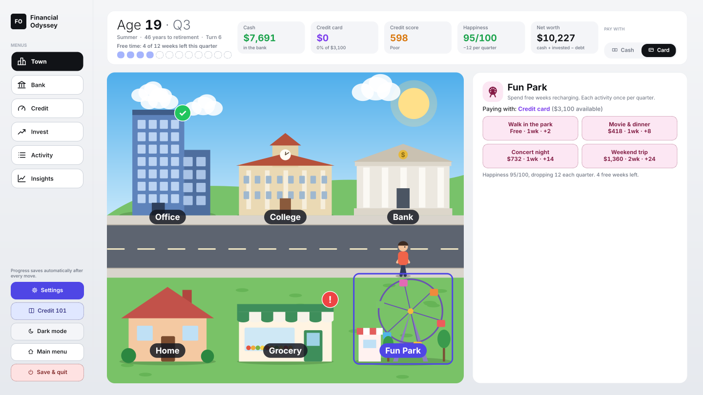
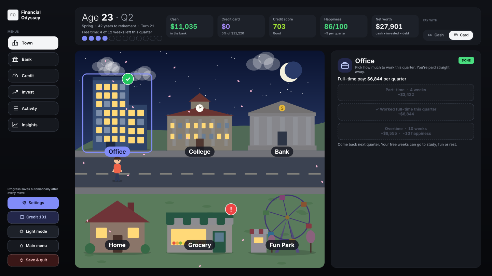
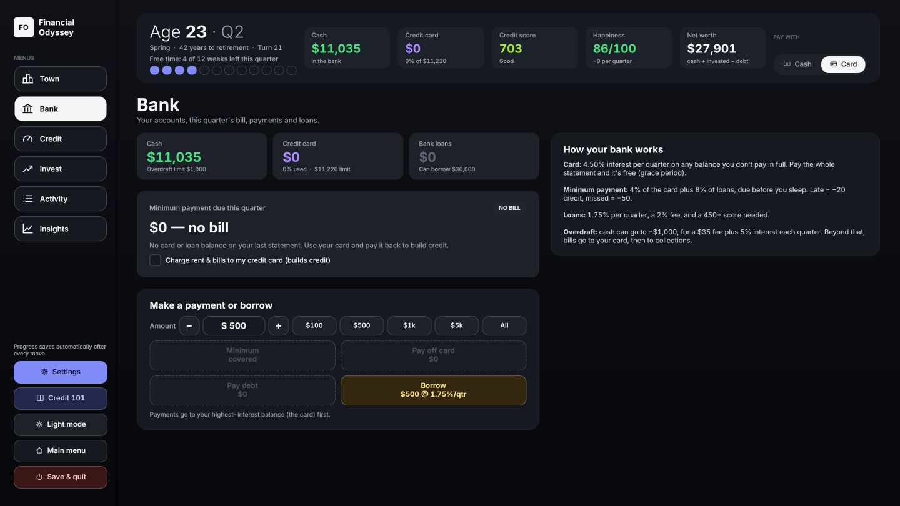
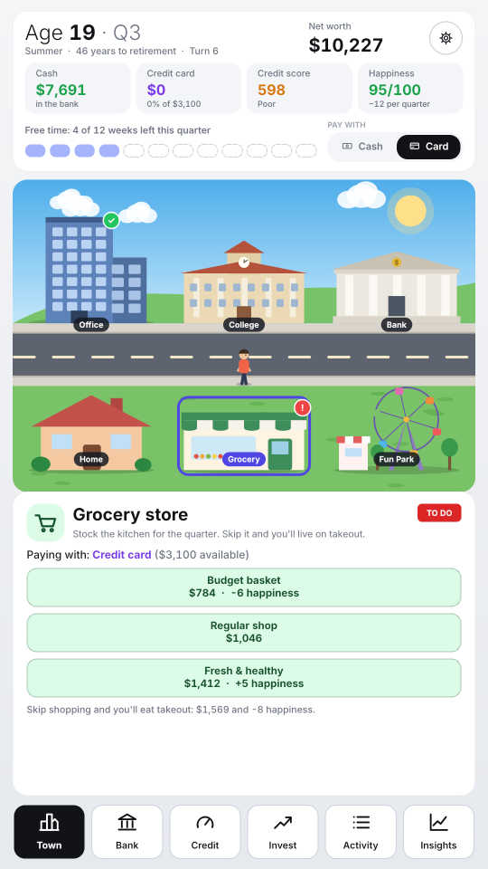

# Financial Odyssey: 18 to 65

A life-simulation game about **credit, debt and building wealth**, made for the Warwick Hackathon 2026 (WHACK, Capital One track).

You start at 18 with $800, your first credit card and a small town to live in. Each turn is one quarter (3 months) with **12 weeks of free time**. Spend them working at the Office, studying at the College or having fun at the Fun Park. Shop for groceries, pay your card at the Bank, then sleep at Home to end the quarter. Build your credit score, invest, and stay happy until you retire at 65 (or earlier, once you reach $1M).



| Night mode (dark theme) | Bank menu | Mobile layout |
|---|---|---|
|  |  |  |

---

## Quick start

Requires **Python 3.10+**.

```bash
pip install -r requirements.txt
```
```bash
python main.py
```

`python -m financial_odyssey` works too.

**Controls:** mouse only: click buildings in town, and menus in the menu bar. **F11** toggles fullscreen and **Esc** leaves it.

---

## How to play

### The town (daily life)
Click a building to walk there and open its panel. Badges show what's left: a red **!** means still to do, a gold **$** means a bill is due, a green tick means done, and a blue **z** on Home means you're ready to sleep.

| Place | What you do there |
|---|---|
| **Office** | Work once per quarter. Part-time (4 weeks, half pay), full-time (8 weeks, full pay) or overtime (10 weeks, 125% pay, −10 happiness). You're paid straight away. |
| **Grocery** | Stock the kitchen for the quarter: budget (cheaper, −6 happiness), regular, or fresh (pricier, +5). Skip it and you live on takeout, which costs 50% more and −8 happiness. |
| **Fun Park** | Spend free weeks on happiness: a free walk in the park, movie & dinner, a concert or a weekend trip. Each once per quarter. |
| **College** | Earn up to 5 certifications (3 weeks each) that permanently raise your pay. Pay for them, or take a student loan. |
| **Bank** | Quick card payments, or open the full Bank menu. |
| **Home** | Sleep to end the quarter. Rent & bills are charged overnight and your card bill is judged. A checklist warns you about anything you forgot. Unused weeks become rest (+1 happiness each). |

**Pay with: Cash / Card** in the status bar decides how town purchases are paid. Using the card and paying it off builds credit; leaving it unpaid costs interest and credit.

### The menus
Open them from the bottom bar (mobile) or the sidebar (desktop):

- **Bank:** balances, this quarter's minimum payment, pay minimum / pay off card / pay any amount, bank loans, and a switch to charge rent & bills to your card.
- **Credit:** score gauge, what tonight's payment will do to it, the five credit tiers, and recent changes.
- **Invest:** put spare cash in the market or take it out. Retire early here at $1M.
- **Activity:** what happened last night and the full log.
- **Insights:** charts of your net worth, credit, money and happiness over your whole life, plus awards.

### Money rules
| Thing | What it means |
|---|---|
| **Cash** | Can go up to $1,000 negative (overdraft), which costs a $35 fee plus interest. |
| **Credit card** | Has a limit set by your credit tier. Paying the full balance means no interest (grace period). |
| **Minimum payment** | Due every quarter: 4% of the card balance plus 8% of loans. Paying less counts as **late (−20)** and paying nothing as **missed (−50)**. |
| **Credit score** | Starts at 550. It only rises when you pay on time (paying in full rises it most). It can't pass 700 until you have 5 years of history. |
| **Credit tiers** | Very Poor, Poor, Fair, Good and Excellent. Your tier sets loan and card rates, your card limit, how much you can borrow, and even your rent and bills (−8% to +16%). |
| **Bank loans** | Cheaper than a card, but you need a score of at least 450. |
| **Investments** | Grow about 5–6% a year with occasional crashes. Withdrawing before 60 costs a 5% fee. |
| **Happiness** | Drains every quarter. Four quarters at 0 is game over. |
| **Life events** | After each night, one of 24 kinds of event: festivals, car repairs, layoffs, inheritances, scams, credit quizzes and more. |

### Ways the game ends
- **Retirement at 65**, or **early retirement** any time your net worth is at least $1M.
- **Depression:** happiness stays at 0 for 4 quarters.
- **IRS seizure:** your credit stays under 300 while you keep missing payments for 8 quarters.

### Final score
Net worth × **credit multiplier**, which ranges from 0.50 for Very Poor up to 2.00 for 900+. If the game ends early, the score is cut and a penalty is subtracted.

### Learning aids
- **Guided tutorial** (19 steps) on your first game: it walks you to each building. Replay it from Settings.
- **First-time tips** explain each action the first time you use it.
- **Credit 101** guide, plus popups explaining why your credit fell and how to recover.

### Tip
Switch **Pay with** to **Card**, then pay the card off at the Bank before you sleep. Your credit grows every quarter and you never pay card interest.

---

## Saving & settings

Progress saves automatically after every move and when the window closes. On the start screen you can **Resume** or **Start a new credit card**, which asks before deleting your save.

Files are stored in your user app-data folder:

| OS | Folder |
|---|---|
| Windows | `%APPDATA%\FinancialOdyssey\Financial Odyssey\` |
| macOS | `~/Library/Application Support/FinancialOdyssey/Financial Odyssey/` |
| Linux | `~/.local/share/FinancialOdyssey/Financial Odyssey/` |

- `savegame.json` holds the current game.
- `settings.json` holds the theme, layout, animations, and tutorial/tips progress.

Settings offer a **light/dark** theme (dark turns the town to night), a **mobile (portrait)** or **desktop (landscape)** layout, **animations on/off** and fullscreen. Every screen is drawn on a fixed canvas and scaled to fit the window, so the layout looks the same at any window size.

---

## Project structure

```
main.py                      launcher: python main.py
requirements.txt
financial_odyssey/
├── __main__.py              python -m financial_odyssey
├── app.py                   creates the QApplication and main window
├── formatting.py            money() and esc() text helpers
├── storage.py               app-data folder, safe JSON read/write
├── engine/                  pure game logic, no Qt (usable from scripts/tests)
│   ├── config.py            GameConfig: every balance number (economy, banking, tiers, daily life…)
│   ├── content.py           achievements and credit-quiz questions
│   ├── state.py             GameState: setup, save/load, history, read-only helpers, scoring
│   ├── credit.py            CreditSystem: credit score changes and credit-drop popups
│   ├── banking.py           Banking: end-of-quarter payments, interest, overdraft, collections
│   ├── actions.py           MoneyMoves: invest, withdraw, borrow, pay debt, retire
│   ├── events.py            LifeEvents: the event deck, 24 events, applying choices
│   ├── daily.py             DailyLife: weeks, work, groceries, fun, college, Cash/Card
│   └── game.py              LifeGame: what happens when you sleep, and the Credit 101 guide
└── ui/                      PyQt6 interface
    ├── theme.py             canvas sizes, light/dark palettes, fonts, stylesheet
    ├── widgets.py           labels, buttons, cards, icons, gauge, nav buttons, amount picker…
    ├── town.py              the painted town: buildings, seasons, night, walking avatar
    ├── places.py            the panel for each building (Home, Office, Grocery…)
    ├── hud.py               status bar: age, free weeks, money, credit, happiness, Cash/Card
    ├── menus/               Bank, Credit, Invest and Activity menus
    ├── overlays.py          event, popup and settings overlays; toasts
    ├── tutorial.py          guided tutorial and first-time tips
    ├── charts.py            line chart used by Insights
    ├── game_ui.py           GameUI controller: owns pages/overlays, routes actions
    ├── view.py              ScaledView: scales the canvas into the window
    ├── window.py            MainWindow: saving, settings, theme/layout, fullscreen
    └── pages/
        ├── start.py         start screen (resume / new game)
        ├── play.py          the main game page: status bar + town/menus + menu bar
        ├── game_over.py     end screen with score breakdown
        └── insights.py      "Your life in charts"
tests/
└── test_engine.py           rule checks for the engine
```

### How the engine fits together

`LifeGame` is built up in layers. Each file adds one class on top of the previous one:

```
GameConfig → GameState → CreditSystem → Banking → MoneyMoves → LifeEvents → DailyLife → LifeGame
```

Each layer only calls methods from the layers below it, so every file can be read on its own, and type checkers like Pyright understand the code fully.

The engine never imports Qt, so you can drive it directly:

```python
from financial_odyssey.engine import LifeGame

g = LifeGame(seed=42)
g.start()
g.work("full")           # paid straight away
g.buy_groceries("regular")
g.do_fun("park")
g.next_turn()            # sleep: one quarter passes; g.state becomes "event"
g.choose_option(0)
print(g.age_years, g.cash, g.credit_score)
```

### The town graphics
All graphics are drawn in code with `QPainter` (`ui/town.py`). There are no image files. The season follows the quarter: snow in winter, blossom in spring, green in summer and falling leaves in autumn. Dark theme turns it into night, with stars and lit windows. Animations (clouds, particles, the ferris wheel, the clock, chimney smoke and the walking avatar) run from one timer inside that single widget, and can be turned off in Settings. The avatar's shirt and hair change as you age.

### Rebalancing
All tuning numbers are in `financial_odyssey/engine/config.py`. Examples are `START_CASH`, `WORK_PLANS`, `GROCERY_PLANS`, `FUN_ACTIVITIES`, `TIERS` and `EVENT_DECK`.

To test the ending quickly, temporarily set `START_CASH = 1_500_000` there and start a new game. Then press **Retire early** at Home or in the Invest menu.

---

## Development

Run the tests (no display needed):

```bash
python -m unittest discover tests
```

Run the type checker:

```bash
pyright
```
